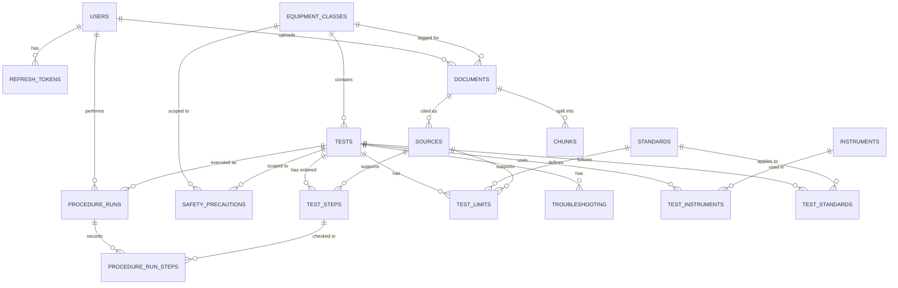

# DB.md — Database Design (SQL + ORM + MongoDB)

Submit this file with `db/schema.sql` as the evidence pack for the DBMS rubric. Each section maps to one rubric (A = SQL, B = ORM, C = MongoDB). The final DBMS score is the **average of the three**, so none of them can be weak.

**Not graded (do not spend time on).** Normalization theory, ACID, query optimisation, indexing.

---

## 1. Why three stores

| Store | Holds | Reason |
|---|---|---|
| **PostgreSQL 16 + pgvector** | Users, sessions, the test catalog, standards, documents, chunks (text + embeddings), procedure runs | Strongly related, constrained data: many-to-many links, keys, checks. Ideal for ER modeling, joins, aggregation |
| **MongoDB 7** | Conversations and messages, feedback, unanswered queries, fault logs, quiz attempts, audit events | Semi-structured, write-heavy, shape varies (citation arrays, variable meter readings, embedded quiz questions) |
| **Redis** | Cache, rate-limit counters, token deny-list, job queue | Not a scored database; supports ASD "advanced capabilities" |

## 2. Rubric A: Relational (SQL)

### 2.1 ER diagram (Crow's Foot, Mermaid)



Draw the final version in draw.io or dbdiagram.io from `schema.sql` and export a PNG into `docs/er-diagram.png` for the report.

### 2.2 Data dictionary (short form)

| Table | Purpose | Key constraints |
|---|---|---|
| `users` | Accounts and role | `email` UNIQUE, `role` enum |
| `refresh_tokens` | Session persistence with expiry and revocation | hashed token UNIQUE, `expires_at > created_at` |
| `equipment_classes` | Transformer, Reactor, Circuit Breaker, Instrument Transformer, Surge Arrester | `name`, `slug` UNIQUE |
| `tests` | A maintenance test on an equipment class | UNIQUE(class, slug); verified rows need verifier + timestamp |
| `test_steps` | Ordered steps (safety / prep / action / record) | UNIQUE(test, step_no), `step_no > 0` |
| `instruments` + `test_instruments` | Test equipment; N:N with tests | composite PK |
| `standards` + `test_standards` | IEC/IEEE/IS/CBIP/CEA references; N:N with tests | `code` UNIQUE, composite PK |
| `test_limits` | Acceptable values with units and conditions | `source_id NOT NULL`, `min <= max`, at least one criterion |
| `safety_precautions` | General, per-equipment or per-test safety text | CHECK ties `scope` to the right foreign key |
| `troubleshooting` | Symptom, probable cause, action | FK to test |
| `synonyms` | Abbreviation and synonym expansion for NLP | UNIQUE(variant, kind) |
| `documents`, `sources`, `chunks` | Uploaded files, citable locations, retrieval chunks | chunk UNIQUE(document, index) |
| `procedure_runs`, `procedure_run_steps` | A user's guided run and per-step confirmations | `checked` requires `checked_at`; UNIQUE(run, step) |

### 2.3 Representative queries used by the application

Keep these in `backend/app/db/queries/analytics.sql` (or `.py`) and reference each from the feature that calls it.

**Q1. Full test record (JOIN across five tables), used by `GET /api/v1/tests/{id}`**
```sql
SELECT t.id, t.name, ec.name AS equipment,
       s.step_no, s.step_type, s.text AS step_text,
       i.name AS instrument, ti.spec_note,
       st.code AS standard_code, ts.clause_note
FROM tests t
JOIN equipment_classes ec ON ec.id = t.equipment_class_id
LEFT JOIN test_steps       s  ON s.test_id = t.id
LEFT JOIN test_instruments ti ON ti.test_id = t.id
LEFT JOIN instruments      i  ON i.id = ti.instrument_id
LEFT JOIN test_standards   ts ON ts.test_id = t.id
LEFT JOIN standards        st ON st.id = ts.standard_id
WHERE t.id = :test_id
ORDER BY s.step_no;
```

**Q2. Catalog coverage per equipment class (LEFT JOIN, GROUP BY, HAVING), used by the admin dashboard**
```sql
SELECT ec.name,
       COUNT(DISTINCT t.id)  AS tests,
       COUNT(l.id)           AS limits
FROM equipment_classes ec
LEFT JOIN tests t       ON t.equipment_class_id = ec.id
LEFT JOIN test_limits l ON l.test_id = t.id
GROUP BY ec.name
HAVING COUNT(DISTINCT t.id) < 8       -- flags classes that still need content
ORDER BY tests;
```

**Q3. Tests with no sourced limit yet (subquery), used by the catalog QA page**
```sql
SELECT t.id, t.name
FROM tests t
WHERE NOT EXISTS (SELECT 1 FROM test_limits l WHERE l.test_id = t.id);
```

**Q4. Most-used procedures (aggregation over runs), used by analytics**
```sql
SELECT t.name, COUNT(*) AS runs,
       ROUND(100.0 * SUM((r.status = 'completed')::int) / COUNT(*), 1) AS completion_pct
FROM procedure_runs r
JOIN tests t ON t.id = r.test_id
GROUP BY t.name
ORDER BY runs DESC
LIMIT 10;
```

**Q5. Per-user progress (CTE), used by Learn Mode "my progress"**
```sql
WITH done AS (
  SELECT user_id, COUNT(*) AS completed
  FROM procedure_runs WHERE status = 'completed' GROUP BY user_id
)
SELECT u.name, COALESCE(d.completed, 0) AS completed_runs
FROM users u LEFT JOIN done d ON d.user_id = u.id
WHERE u.role = 'trainee'
ORDER BY completed_runs DESC;
```

**Q6. Standards referenced by the most tests (aggregation)**
```sql
SELECT st.code, st.title, COUNT(ts.test_id) AS tests_using
FROM standards st JOIN test_standards ts ON ts.standard_id = st.id
GROUP BY st.id ORDER BY tests_using DESC;
```

**Q7. Hybrid retrieval with Reciprocal Rank Fusion (vector + full-text)**
```sql
WITH vec AS (
  SELECT id, ROW_NUMBER() OVER (ORDER BY embedding <=> :qvec) AS r
  FROM chunks WHERE (:eq IS NULL OR equipment_class_id = :eq)
  ORDER BY embedding <=> :qvec LIMIT 20
), kw AS (
  SELECT c.id, ROW_NUMBER() OVER (ORDER BY ts_rank_cd(c.tsv, q) DESC) AS r
  FROM chunks c, websearch_to_tsquery('english', :qtext) q
  WHERE c.tsv @@ q AND (:eq IS NULL OR c.equipment_class_id = :eq)
  ORDER BY ts_rank_cd(c.tsv, q) DESC LIMIT 20
)
SELECT c.id, c.content, c.page_start, c.section_title,
       COALESCE(1.0/(60+vec.r), 0) + COALESCE(1.0/(60+kw.r), 0) AS score
FROM chunks c
LEFT JOIN vec ON vec.id = c.id
LEFT JOIN kw  ON kw.id  = c.id
WHERE vec.id IS NOT NULL OR kw.id IS NOT NULL
ORDER BY score DESC LIMIT 20;
```

**DML that respects integrity.** Deleting a test cascades to its steps, limits, troubleshooting and safety rows; it is *blocked* (`RESTRICT`) if any `procedure_runs` reference it. Deleting a user is a soft delete (`is_active = false`) so MongoDB documents that store `user_id` never dangle.

### 2.4 Be ready to write live in the viva

Practice writing, from memory: a join across three tables, a GROUP BY with HAVING, a NOT EXISTS subquery, and a CTE, all against this schema.

## 3. Rubric B: ORM (SQLAlchemy 2.0)

- **Models mirror the DDL** one-to-one in `backend/app/db/models/` (one file per aggregate: `user.py`, `catalog.py`, `documents.py`, `runs.py`). Field types, nullability, defaults and enums match `schema.sql`.
- **CRUD only through the ORM** in repository classes (`TestRepository.create/get/list/update/delete`), using `select()`, `.where()`, `.order_by()`, `.limit()/.offset()` for filtering, sorting, pagination.
- **Relationships declared:**
  - 1:N: `EquipmentClass.tests`, `Test.steps`, `Test.limits`, `Test.troubleshooting`
  - N:N: `Test.instruments` via `test_instruments`, `Test.standards` via `test_standards`
  - 1:1-style: `User.refresh_tokens` (1:N), `ProcedureRun.steps`
- **Loading.** `selectinload` for the test detail page (avoids N+1 without SQL tuning talk); lazy loading elsewhere.
- **Cascades.** `cascade="all, delete-orphan"` on `Test.steps/limits/troubleshooting`, matching `ON DELETE CASCADE` in the DDL.
- **Model-level validation.** Pydantic schemas for request bodies plus SQLAlchemy `CheckConstraint` and `Enum` types.
- **Migrations.** Alembic (`alembic revision --autogenerate`, `alembic upgrade head`). Be ready to explain how adding a column flows from model to migration to database.
- **Where raw SQL is used and why.** The analytics and hybrid-retrieval queries in section 2.3, executed with `session.execute(text(...))`, because they are multi-table reports or use pgvector operators that read more clearly as SQL. Everything else goes through the ORM.

## 4. Rubric C: MongoDB (PyMongo/Motor, no ODM)

Use Motor (async PyMongo) directly with Pydantic models. Skipping an ODM keeps this scored under Rubric C only, so nothing is scored twice.

### 4.1 Collections and design choices

| Collection | Shape | Embed or reference (and why) |
|---|---|---|
| `conversations` | `{_id, user_id, title, mode, equipment, created_at, updated_at}` | Lightweight header; messages are kept separate |
| `messages` | `{_id, conversation_id, role, content, intent, entities, citations[], confidence, source_type, latency_ms, created_at}` | **Reference** the conversation because a chat can grow long and messages are read in pages. **Embed** `citations[]` because they belong to one message and are always read with it |
| `feedback` | `{_id, message_id, user_id, rating, comment, created_at}` | **Reference** the message; feedback is created and queried independently |
| `unanswered_queries` | `{_id, query, intent, equipment, top_score, count, first_seen, last_seen}` | Self-contained; upsert increments `count` for repeats |
| `fault_logs` | `{_id, equipment_class, equipment_tag, symptoms[], readings{...}, diagnosis, resolution, logged_at}` | `readings` differs by equipment (dissolved gas values for a transformer, SF6 pressure for a breaker), which suits documents better than fixed columns |
| `quiz_attempts` | `{_id, user_id, equipment_class, questions:[{q, options[], correct, chosen}], score, total, created_at}` | **Embed** questions because they only make sense inside the attempt |
| `audit_events` | `{_id, user_id, action, target, at, meta{}}` | Append-only log |

### 4.2 Sample documents (include in the report)

```json
// messages
{
  "_id": "ObjectId(...)",
  "conversation_id": "ObjectId(...)",
  "role": "assistant",
  "intent": "limits",
  "entities": {"equipment": "Circuit Breaker", "test": "Contact Resistance"},
  "content": "...",
  "citations": [{"n": 1, "document_id": 12, "page": 14, "section": "Test limits"}],
  "confidence": 0.86,
  "source_type": "catalog+rag",
  "latency_ms": 2140,
  "created_at": "2026-10-04T10:21:00Z"
}
```
```json
// fault_logs
{
  "equipment_class": "Power Transformer",
  "equipment_tag": "TR-2",
  "symptoms": ["high winding temperature", "gas alarm"],
  "readings": {"H2_ppm": 0, "CH4_ppm": 0, "C2H2_ppm": 0, "oil_temp_c": 0},
  "diagnosis": "…",
  "resolution": "…",
  "logged_at": "2026-09-30T08:00:00Z"
}
```

_Numbers above are placeholders for the shape; the seed script generates realistic synthetic values._

### 4.3 Operations used by the app

```python
# insert
await db.messages.insert_one(doc)

# filtered find with projection and pagination (only fields the UI needs)
cursor = db.messages.find({"conversation_id": cid}, {"content": 1, "role": 1, "citations": 1, "created_at": 1}) \
                    .sort("created_at", 1).skip(offset).limit(limit)

# update with operators
await db.unanswered_queries.update_one({"query": q}, {"$inc": {"count": 1}, "$set": {"last_seen": now}}, upsert=True)
await db.conversations.update_one({"_id": cid, "user_id": uid}, {"$set": {"title": t, "updated_at": now}})

# delete (owner only)
await db.conversations.delete_one({"_id": cid, "user_id": uid})
```

**Aggregations**

> `$lookup` matches on exact BSON type. `feedback.message_id` must be stored as an `ObjectId` — the same type as `messages._id` — not as a string. If it's inserted as a string (easy to do if the API accepts it as a path param and passes it straight through), the `$lookup` below returns an empty array for every document with no error, and `avg_rating` comes back `null` for everything. Convert with `ObjectId(message_id)` at the repository boundary before any write.

```python
# Average feedback rating per equipment (joins across collections with $lookup)
[
  {"$lookup": {"from": "messages", "localField": "message_id", "foreignField": "_id", "as": "m"}},
  {"$unwind": "$m"},
  {"$group": {"_id": "$m.entities.equipment", "avg_rating": {"$avg": "$rating"}, "n": {"$sum": 1}}},
  {"$sort": {"avg_rating": 1}}
]

# Top unanswered queries this week
[
  {"$match": {"last_seen": {"$gte": week_start}}},
  {"$sort": {"count": -1}}, {"$limit": 10},
  {"$project": {"_id": 0, "query": 1, "count": 1, "intent": 1}}
]

# Messages per day
[
  {"$group": {"_id": {"$dateToString": {"format": "%Y-%m-%d", "date": "$created_at"}}, "messages": {"$sum": 1}}},
  {"$sort": {"_id": 1}}
]
```

Optional: a JSON Schema validator on `messages` and `quiz_attempts` (`db.create_collection(..., validator={...})`) to show consistent document shapes.

### 4.4 Keeping SQL and MongoDB consistent

- Mongo documents store `user_id`, `test_id` and `equipment_class` as plain values from Postgres; there are no cross-database foreign keys.
- Users are never hard-deleted, so those ids never dangle.
- Catalog facts are never copied into Mongo; messages store only ids and citations. The catalog stays the single source of truth for limits.
- If a test is renamed, old messages still read correctly because they store `test_id` and the name at the time is only display text.

### 4.5 Why MongoDB here (viva answer)

Chat logs, feedback and fault logs are write-heavy, grow steadily, and have varying shapes. A document model fits them without schema changes for every new reading type. The catalog is the opposite: strongly related and constrained, so it lives in SQL.

## 5. Seed data (both stores)

`python -m app.scripts.seed` loads: 5 equipment classes, 40+ tests with steps, limits, instruments and standards, about 300 synonyms, demo users for each role, about 50 sample conversations, 100 synthetic fault logs, and sample documents. Realistic seed data is an explicit ASD criterion.
