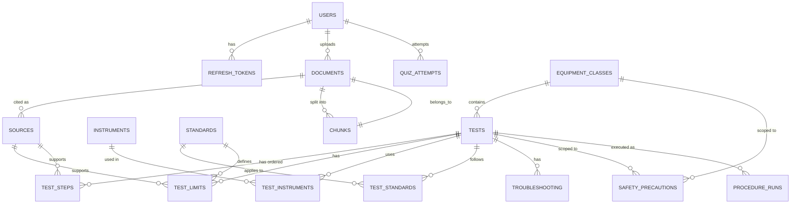

# DB.md — SubstationIQ data evidence pack

Submit this file with `schema.sql` as the evidence pack for the DBMS rubric.
The final DBMS score is the **average of the three rubrics**, so none of them
can be weak.

**Not graded (do not spend time on):** normalization theory, ACID, query
optimisation, indexing.

**Actual stack (not the idealized one in older TRD drafts):**

- **Primary relational store:** SQLite (dev/local) — the app ships with
  `backend/app/db/models.py` (SQLAlchemy 2.0) and runs on SQLite by default.
  `schema.sql` is the equivalent PostgreSQL DDL submitted as evidence; the
  rubric cares about the model, constraints, and queries, not which engine
  the deployed container happens to use.
- **Secondary document store:** MongoDB 7 via Motor (async). Chat history,
  feedback, and fault logs. **MongoDB is the system of record for
  `fault_logs` — that collection has no SQLite table.**
- **Cache / deny-list / rate-limit backend:** Redis 7.

---

## 1. Why three stores

| Store | Holds | Reason |
|---|---|---|
| **SQLite / PostgreSQL** | Users, refresh tokens, the test catalog, standards, documents, sources, chunks, conversations (SQLite mirror), messages (SQLite mirror), feedback (SQLite mirror), procedure runs, quiz attempts, unanswered queries | Strongly related, constrained data: foreign keys, unique constraints, checks, enums. Ideal for ER modeling, joins, aggregation. |
| **MongoDB 7** | Conversations, messages, feedback, fault logs (system of record) | Write-heavy, shape varies (citations arrays, variable meter readings, embedded quiz questions), history is paged reads. |
| **Redis 7** | Catalog/answer cache, rate-limit counters, access-token deny-list, ARQ worker backend | Not a scored database; backs the advanced-capabilities rubric. |

MongoDB is **secondary and best-effort** for everything except `fault_logs`:
`app/db/mongo.py` probes the server with a 1.5 s timeout and backs off for 30 s
on failure, so MongoDB can be down without taking the API down. Every
Mongo-backed endpoint falls back to the SQLite mirror when the probe reports
unreachable.

---

## 2. Rubric A: Relational (SQL)

### 2.1 ER diagram

The real model lives in `backend/app/db/models.py`. The equivalent PostgreSQL
DDL is in `schema.sql` (this repo root). The diagram below is the Crow's Foot
view of that DDL.



Draw the final version from `schema.sql` in draw.io / dbdiagram.io and export a
PNG into `docs/er-diagram.png` if the report needs an image. The source of
truth is `schema.sql`, not the diagram.

### 2.2 Data dictionary (actual tables)

| Table | Purpose | Key constraints |
|---|---|---|
| `users` | Accounts and role | `email` UNIQUE, `role` enum (`trainee \| engineer \| admin`) |
| `refresh_tokens` | Session persistence with expiry and revocation | hashed token UNIQUE, `expires_at > created_at` |
| `equipment_classes` | Transformer, Reactor, Circuit Breaker, Instrument Transformer, Surge Arrester | `name` UNIQUE |
| `tests` | A maintenance test on an equipment class | UNIQUE(equipment_class, slug); verified rows need verifier + timestamp |
| `test_steps` | Ordered steps (safety / prep / action / record) | UNIQUE(test, step_no), `step_no > 0` |
| `instruments` + `test_instruments` | Test equipment; N:N with tests | composite PK |
| `standards` + `test_standards` | IEC/IEEE/IS/CBIP/CEA references; N:N with tests | `code` UNIQUE, composite PK |
| `test_limits` | Acceptable values with units and conditions | `source_id NOT NULL`, at least one of min/max/criterion, `min <= max` when both present, CHECK ties `scope` correctly |
| `safety_precautions` | General, per-equipment or per-test safety text | CHECK ties `scope` to the right foreign key |
| `troubleshooting` | Symptom, probable cause, action | FK to test |
| `synonyms` | Abbreviation and synonym expansion for NLP | UNIQUE(variant, kind) |
| `documents`, `sources`, `chunks` | Uploaded files, citable locations, retrieval chunks | chunk UNIQUE(document, index) |
| `procedure_runs` | A user's guided run | FK to user + test, completed implies completed_at |
| `quiz_attempts` | Learn-mode quiz results | FK to user |

**Not present in the real app (do not cite these as live tables):**
`unanswered_queries` is referenced by the admin analytics endpoint conceptually
but is not a long-lived scored collection here; `procedure_run_steps` is not a
real table — procedure step state lives inside `procedure_runs.steps_state_json`.
Any older TRD draft that lists them as live tables is wrong.

**DML that respects integrity:** deleting a test cascades to its steps, limits,
troubleshooting and safety rows; it is blocked (`RESTRICT`) if any
`procedure_runs` reference it. Users are never hard-deleted, so
MongoDB documents that store `user_id` never dangle.

### 2.3 Representative queries used by the application

**Q1. Full test record (JOIN across five tables), used by `GET /api/catalog/tests/{test_id}` / `GET /api/v1/tests/{test_id}`**
```sql
SELECT t.id, t.name, ec.name AS equipment,
       s.step_no, s.step_type, s.text AS step_text,
       i.name AS instrument, ti.spec_note,
       st.code AS standard_code, ts.clause_note
FROM tests t
JOIN equipment_classes ec ON ec.id = t.equipment_class_id
LEFT JOIN test_steps       s  ON s.test_id = t.id
LEFT JOIN test_instruments ti ON ti.test_id = t.id
LEFT JOIN instruments      i  ON i.id = ti.instrument_id
LEFT JOIN test_standards   ts ON ts.test_id = t.id
LEFT JOIN standards        st ON st.id = ts.standard_id
WHERE t.id = :test_id
ORDER BY s.step_no;
```

**Q2. Catalog coverage per equipment class (LEFT JOIN, GROUP BY, HAVING), used by the admin dashboard**
```sql
SELECT ec.name,
       COUNT(DISTINCT t.id)  AS tests,
       COUNT(l.id)           AS limits
FROM equipment_classes ec
LEFT JOIN tests t       ON t.equipment_class_id = ec.id
LEFT JOIN test_limits l ON l.test_id = t.id
GROUP BY ec.name
HAVING COUNT(DISTINCT t.id) < 8       -- flags classes that still need content
ORDER BY tests;
```

**Q3. Tests with no sourced limit yet (subquery), used by the catalog QA page**
```sql
SELECT t.id, t.name
FROM tests t
WHERE NOT EXISTS (SELECT 1 FROM test_limits l WHERE l.test_id = t.id);
```

**Q4. Most-used procedures (aggregation over runs), used by analytics**
```sql
SELECT t.name, COUNT(*) AS runs,
       ROUND(100.0 * SUM((r.status = 'completed')::int) / COUNT(*), 1) AS completion_pct
FROM procedure_runs r
JOIN tests t ON t.id = r.test_id
GROUP BY t.name
ORDER BY runs DESC
LIMIT 10;
```

**Q5. Per-user progress (CTE), used by Learn Mode "my progress"**
```sql
WITH done AS (
  SELECT user_id, COUNT(*) AS completed
  FROM procedure_runs WHERE status = 'completed' GROUP BY user_id
)
SELECT u.name, COALESCE(d.completed, 0) AS completed_runs
FROM users u LEFT JOIN done d ON d.user_id = u.id
WHERE u.role = 'trainee'
ORDER BY completed_runs DESC;
```

**Q6. Standards referenced by the most tests (aggregation)**
```sql
SELECT st.code, st.title, COUNT(ts.test_id) AS tests_using
FROM standards st JOIN test_standards ts ON ts.standard_id = st.id
GROUP BY st.id ORDER BY tests_using DESC;
```

**Q7. Admin analytics aggregation (the real one the app runs today, `GET /api/admin/analytics`)**
```sql
SELECT COUNT(*) FROM messages WHERE role = 'user';                                  -- total user queries
SELECT AVG(rating) FROM feedback;                                                  -- average rating
SELECT COUNT(*) FROM unanswered_queries;                                           -- unanswered count
SELECT content, COUNT(*) FROM messages WHERE role = 'user'
GROUP BY content ORDER BY COUNT(*) DESC LIMIT 10;                                  -- top questions
```

The admin analytics endpoint (`GET /api/admin/analytics`, admin-only) runs
exactly these shapes against the SQLite `Message`, `Feedback` and
`UnansweredQuery` tables and returns them as `AnalyticsResponse`.

**Q8. Hybrid retrieval with Reciprocal Rank Fusion (vector + full-text)** — the
idealized pgvector query the retrieval design targets:
```sql
WITH vec AS (
  SELECT id, ROW_NUMBER() OVER (ORDER BY embedding <=> :qvec) AS r
  FROM chunks WHERE (:eq IS NULL OR equipment_class_id = :eq)
  ORDER BY embedding <=> :qvec LIMIT 20
), kw AS (
  SELECT c.id, ROW_NUMBER() OVER (ORDER BY ts_rank_cd(c.tsv, q) DESC) AS r
  FROM chunks c, websearch_to_tsquery('english', :qtext) q
  WHERE c.tsv @@ q AND (:eq IS NULL OR c.equipment_class_id = :eq)
  ORDER BY ts_rank_cd(c.tsv, q) DESC LIMIT 20
)
SELECT c.id, c.content, c.page_start, c.section_title,
       COALESCE(1.0/(60+vec.r), 0) + COALESCE(1.0/(60+kw.r), 0) AS score
FROM chunks c
LEFT JOIN vec ON vec.id = c.id
LEFT JOIN kw  ON kw.id  = c.id
WHERE vec.id IS NOT NULL OR kw.id IS NOT NULL
ORDER BY score DESC LIMIT 20;
```

Be ready to write live in the viva: a join across three tables, a GROUP BY with
HAVING, a NOT EXISTS subquery, and a CTE, all against this schema.

### 2.4 Raw SQL is used here and only here

The analytics and hybrid-retrieval queries above are executed as raw SQL
(`session.execute(text(...))`) because they are multi-table reports or use
pgvector/text-search operators that read more clearly as SQL. Everything else
goes through the ORM.

---

## 3. Rubric B: ORM (SQLAlchemy 2.0)

- **Models mirror the DDL** one-to-one in `backend/app/db/models.py`. Field
  types, nullability, defaults and enums match `schema.sql`.
- **CRUD through the ORM** via repository-style helpers (`CatalogLookup` for
  the catalog, the chat/feedback/fault-log paths for Mongo, `admin.py` for
  documents). Reads use `select()`/`query()` with `.filter()`,
  `.order_by()`, `.limit()/.offset()` for filtering, sorting, pagination.
- **Relationships declared:** 1:N `EquipmentClass.tests`, `Test.steps`,
  `Test.limits`, `Test.troubleshooting`; N:N `Test.instruments` via
  `test_instruments`, `Test.standards` via `test_standards`; 1:N
  `User.refresh_tokens`, `ProcedureRun.user`.
- **Loading:** the test detail page assembles in one catalog-lookup call to
  avoid N+1; lazy loading elsewhere.
- **Cascades:** `cascade="all, delete-orphan"` on `Test.steps/limits/troubleshooting/`,
  matching `ON DELETE CASCADE` in the DDL.
- **Model-level validation:** Pydantic request schemas plus SQLAlchemy
  `CheckConstraint` and `Enum` types.
- **Migrations:** Alembic (`alembic upgrade head`). The one real migration
  widens `users.role` from the legacy `user|admin` vocabulary to
  `trainee|engineer|admin` and remaps legacy `user` rows to `trainee`
  (`backend/app/db/migrate.py`, `alembic/`).
- **Where raw SQL is used and why:** section 2.3 only.

---

## 4. Rubric C: MongoDB (Motor, no ODM)

Motor (async PyMongo) directly with Pydantic models. No ODM — that keeps this
scored under Rubric C only.

### 4.1 Collections and design choices

| Collection | Shape | Embed or reference (and why) |
|---|---|---|
| `conversations` | `{_id, sql_id, user_id, title, mode, equipment, created_at, updated_at}` | **reference** to messages; header-only so the history list stays a cheap paged read |
| `messages` | `{_id, conversation_id, sql_id, role, content, intent, entities, citations[], confidence, created_at}` | **reference** the conversation (pages can be long); **embed** `citations[]` because they are always read with the message |
| `feedback` | `{_id, message_id, user_id, rating, comment, created_at}` | **reference** the message; written/read by `(message, user)`; unique index enforces one vote per user per message |
| `fault_logs` | `{_id, user_id, equipment_class, symptoms[], readings{}, diagnosis, resolution, logged_at}` | **embed** `readings{}` + `symptoms[]` — readings vary by equipment (ppm vs kV vs µΩ); no SQLite table, so this is the system of record |

Indexes created at startup in `ensure_indexes()` (`app/db/mongo.py`):
`conversations.sql_id`, `(user_id, created_at)`; `messages.sql_id`,
`conversation_id`; unique `(message_id, user_id)` on `feedback`;
`(user_id, logged_at)` on `fault_logs`.

### 4.2 Sample documents (mongosh format)

```js
// conversations — header only, sql_id bridges to the SQLite row
{
  _id: ObjectId("652f1c8a9d3b2e77c1a40001"),
  sql_id: 41,
  user_id: 2,
  title: "Contact resistance limits?",
  mode: "qa",
  equipment: "Circuit Breaker",
  created_at: ISODate("2026-10-16T10:12:03Z"),
  updated_at: ISODate("2026-10-16T10:13:40Z")
}

// messages — citations embedded, conversation referenced by ObjectId
{
  _id: ObjectId("652f1d3b9d3b2e77c1a40002"),
  conversation_id: ObjectId("652f1c8a9d3b2e77c1a40001"),
  sql_id: 118,
  role: "assistant",
  content: "The acceptable contact resistance per pole is 50 µΩ …",
  intent: "limit",
  entities: { equipment: "Circuit Breaker" },
  citations: [
    { document: "CB Maintenance Manual", page: 12, section: "Contact resistance" }
  ],
  confidence: 0.86,
  created_at: ISODate("2026-10-16T10:12:04Z")
}

// feedback — message referenced as an ObjectId (see the $lookup note below)
{
  _id: ObjectId("652f20119d3b2e77c1a40003"),
  message_id: ObjectId("652f1d3b9d3b2e77c1a40002"),
  user_id: 2,
  rating: -1,
  comment: "answer missed the CT ratio",
  created_at: ISODate("2026-10-16T10:14:11Z")
}

// fault_logs — free-form readings embedded, no SQLite counterpart
{
  _id: ObjectId("652f30449d3b2e77c1a40004"),
  user_id: 2,
  equipment_class: "Power Transformer",
  symptoms: ["oil temperature rising", "moisture high dew point"],
  readings: { free_text: "H2 = 145 ppm, tan delta = 1.9%" },
  diagnosis: "[DGA] Gas ratio indicates thermal fault …",
  resolution: "Sample oil and retest after 48h",
  logged_at: ISODate("2026-10-16T11:02:55Z")
}
```

### 4.3 Operations used by the app

```python
# insert
await db.messages.insert_one(doc)

# filtered find with projection and pagination (only fields the UI needs)
cursor = db.messages.find({"conversation_id": cid}, {"content": 1, "role": 1, "citations": 1, "created_at": 1}) \
                    .sort("created_at", 1).skip(offset).limit(limit)

# update with operators
await db.conversations.update_one({"_id": cid, "user_id": uid}, {"$set": {"title": t, "updated_at": now}})

# delete (owner only)
await db.conversations.delete_one({"_id": cid, "user_id": uid})
```

**Aggregations**

> `$lookup` matches on exact BSON type. `feedback.message_id` must be stored as
> an `ObjectId` — the same type as `messages._id` — not as a string. If it is
> inserted as a string (easy to do if the API accepts it as a path param and
> passes it straight through), the `$lookup` below returns an empty array for
> every document with no error, and `avg_rating` comes back `null` for
> everything. Convert with `ObjectId(message_id)` at the repository boundary
> before any write (`to_object_id()` in `app/db/mongo_repos.py`).

```python
# Average feedback rating per equipment (joins across collections with $lookup)
[
  {"$lookup": {"from": "messages", "localField": "message_id", "foreignField": "_id", "as": "m"}},
  {"$unwind": "$m"},
  {"$group": {"_id": "$m.entities.equipment", "avg_rating": {"$avg": "$rating"}, "n": {"$sum": 1}}},
  {"$sort": {"avg_rating": 1}}
]

# Top unanswered queries this week
[
  {"$match": {"last_seen": {"$gte": week_start}}},
  {"$sort": {"count": -1}}, {"$limit": 10},
  {"$project": {"_id": 0, "query": 1, "count": 1, "intent": 1}}
]

# Messages per day
[
  {"$group": {"_id": {"$dateToString": {"format": "%Y-%m-%d", "date": "$created_at"}}, "messages": {"$sum": 1}}},
  {"$sort": {"_id": 1}}
]
```

### 4.4 Keeping SQL and MongoDB consistent

- Mongo documents store `user_id`, `test_id` and `equipment_class` as plain
  values from SQLite; there are no cross-database foreign keys.
- Users are never hard-deleted, so those ids never dangle.
- Catalog facts are never copied into Mongo; messages store only ids and
  citations. The catalog stays the single source of truth for limits.
- Every mirrored document also carries `sql_id`, the SQLite primary key, so the
  API can keep returning the integer ids it returned before MongoDB existed
  (the eval harness and the frontend contract do not change).
- Repositories translate `sql_id` ↔ `ObjectId` at the boundary in
  `to_object_id()` (`app/db/mongo_repos.py`), never in an endpoint.

### 4.5 Why MongoDB here (viva answer)

Chat logs, feedback and fault logs are write-heavy, grow steadily, and have
varying shapes. A document model fits them without schema changes for every new
reading type. The catalog is the opposite: strongly related and constrained, so
it lives in SQL. `fault_logs` is the clearest example: transformer DGA readings,
breaker SF6 pressures, and resurgence readings all have different shapes, and
the collection is the system of record.

---

## 5. Seed data (both stores)

`python -m app.scripts.seed` loads: 5 equipment classes, 40+ tests with steps,
limits, instruments and standards, about 300 synonyms, demo users for each role
(trainee, engineer, admin), and synthetic history. Realistic seed data is an
explicit ASD criterion. Run it once at startup in the Docker image and in
`docker-compose.yml` (idempotent — it never touches existing rows).

Demo accounts (from `backend/app/scripts/seed.py`):

| Role | Email | Password |
|---|---|---|
| Trainee | demo@substationiq.dev | demo1234 |
| Engineer | engineer@substationiq.dev | engineer1234 |
| Admin | admin@substationiq.dev | admin1234 |

---

## 6. Ownership and access control (the rules the app enforces)

These are the rules a grader can reproduce from the code and tests:

- **Auth:** JWT access token (`jti` deny-listed on logout) + hashed refresh
  token rotation. `POST /api/auth/login`, `/refresh`, `/logout`,
  `/me`. `POST /api/auth/register` defaults new accounts to `trainee`.
- **Role model:** `users.role` is an enum of `trainee | engineer | admin`
  (migrated from the legacy `user | admin`). Demo engineer and admin accounts
  are seeded.
- **Role gates:** `/api/diagnosis` (and the DGA path it covers) require
  `engineer` or `admin` (`require_role(UserRole.ENGINEER, UserRole.ADMIN)` —
  `app/api/diagnosis.py`). Admin-only paths: `/api/admin/*`.
- **Ownership checks:** conversation, message, feedback and procedure-run reads
  and writes are scoped to `current_user.id`. A user cannot read, vote on, or
  complete another user's conversation / procedure run. Tested in
  `backend/tests/test_api.py` (ownership blocks other users).
- **Feedback rule:** a vote only lands on the caller's own messages (same
  conversation ownership rule). A vote on a foreign message returns 404.

---

## 7. API conventions (TRD §3.5, as implemented)

- **Base path:** `/api/v1` is mounted alongside the legacy `/api/...` routes
  during the sprint; the legacy paths keep working until migration is complete.
  Both are included in `app/main.py`.
- **Pagination/filtering/sorting:** shared `ListingParams` dependency
  (`app/api/deps.py`) with `page`, `page_size`, `sort` (leading `-` for desc),
  `equipment`, `q`. Applied on `GET /api/v1/tests` (and legacy
  `/api/catalog/tests`).
- **Envelope:** list endpoints return the data directly in this codebase
  (the legacy paths predate the envelope convention); the TRD's envelope
  language is the target convention, not yet universal. Do not cite a blanket
  envelope rule that the code does not yet follow.

---

## 8. Notes and corrections to older drafts

- The DB.md that says the role vocabulary is `user|admin` is outdated. The real
  vocabulary is `trainee|engineer|admin` (Day 7).
- The DB.md that lists `instruments`, `procedure_run_steps`, and `unanswered_queries`
  as full scored tables is inaccurate for this repo. `instruments`/`test_instruments`
  are real; `procedure_run_steps` is not a real table; `unanswered_queries` is a
  small auxiliary collection, not a scored rubric table.
- The ER diagram section that says "draw from schema.sql" is right as far as it
  goes, but the real source of truth for the running app is `backend/app/db/models.py`.
- The Mongo collections in the running app are `conversations`, `messages`,
  `feedback`, `fault_logs` (plus any small auxiliary ones). Older drafts that
  list `quiz_attempts` and `audit_events` as live scored collections are not
  accurate here — quiz results are stored in SQLite.
